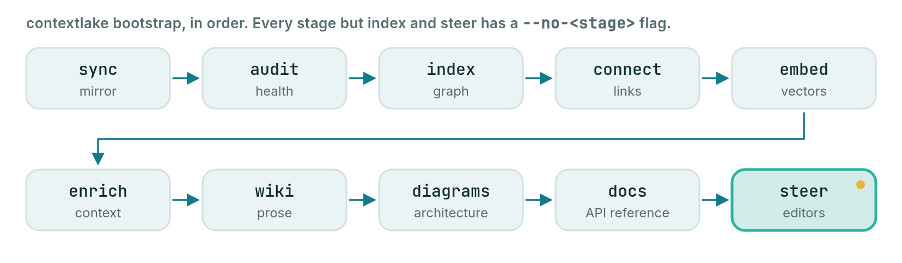

# Quickstart

For anyone who wants a first result: on one local repo, or on a whole GitLab fleet.

This page takes you from a fresh machine to a wired AI workspace. At the end, your GitLab repos
are mirrored, indexed into a local knowledge graph, and exposed to Claude Code, Windsurf and Kiro.
Everything beyond the mirror is optional. This quickstart turns on four things:

- **The code graph.** `bootstrap` always builds it.
- **Semantic search.** It is on by default and needs an embedder (step 2 installs one).
- **The wiki.** It is off unless you pass `--llm` or enable `[llm]`. Step 4 passes `--llm builtin`.
- **Connectors.** They are off until `kb.toml` has a `[[sources]]` entry. The example in step 3 adds one.

<p align="center">
  
</p>

## Try it on one repo, no setup

You need no GitLab and no config file to try contextlake on a repo you already have. Run these
in that repo's directory:

```bash
contextlake kb index                     # parse the current repo into a local knowledge graph
contextlake kb graph --overview --open   # open the graph (it names your repo's own view next)
contextlake kb serve                     # or serve it to your AI editor over MCP
```

- **Not installed yet?** Run any command once with [`uvx`](https://docs.astral.sh/uv/). Put
  `uvx --from "contextlake[kb-full]"` in front of it, for example
  `uvx --from "contextlake[kb-full]" contextlake kb index`.
- **Where it lands.** The graph goes to a local store at `~/.contextlake/kb`. Nothing leaves your machine.
- **Other paths.** Index any path with `--source PATH`. Index every git repo under a directory with
  `--workspace DIR`.

To mirror a whole GitLab group, build the full knowledge layer and wire your editor, follow the
fleet path below.

## The fleet path

The steps below mirror a fleet of repos, index them, and wire your editor.


## 1. Prerequisites

- **Python 3.10+**, one floor for the whole tool, mirror and knowledge layer alike
- **`git`**, plus your platform's token: **`GITLAB_TOKEN`** (a personal access token, PAT, with
  `read_api` + `read_repository`), or `GITHUB_TOKEN` / `BITBUCKET_TOKEN` / `GITEA_TOKEN` with
  `platform = github|bitbucket|gitea` in the config. On GitLab, an authenticated
  **`glab`** (`glab auth login`) works instead of a token.

## 2. Install

```bash
pipx install "contextlake[kb-full]"
```

`pipx` keeps contextlake in its own environment and still puts the command on your PATH.
`[kb-full]` is an extra, an optional add-on: a group of packages you install with contextlake. This one
installs:

- the knowledge layer;
- the built-in CPU embedder (no Ollama, no API key);
- the `sqlite-vec` backend.

Only `[kb-full]` adds the embedder, so semantic search works with no extra setup. The plain `[kb]`
extra leaves it out.

The install gives you the `contextlake` command. `python -m contextlake` works too.
`python3 run-contextlake.py` is a source-checkout launcher and is not in the package.

Using pip, uv, Docker, or a standalone binary instead, or picking extras one by one? Every
channel is on one page: **[Installing and upgrading](docs/installing.md)**. It also has the
[extras table](docs/installing.md#the-extras-and-which-one-you-want), upgrading, and uninstalling.

Check the install, whichever channel you chose:

```bash
contextlake --version
contextlake doctor
```

`doctor` reports what is present and what is missing. If it names something you cannot
resolve, [Troubleshooting](docs/troubleshooting.md) covers the failures that come up most.

## 3. Configure

The fast path, `contextlake init` writes both config files for you (interactive, or
`--skip-interactive` for defaults):

```bash
contextlake init                       # prompts for platform, group, workspace
contextlake init --platform github --group my-org --skip-interactive   # non-interactive
contextlake init --local               # scope config to this project instead of ~/
```

Working across more than one org or project? `--local` writes config into the current directory instead
of `~/`; every subdirectory underneath it inherits it automatically (see
[Directory-scoped config](docs/configuration.md#directory-scoped-config)).

Prefer to write them by hand? **Mirror config**, `~/.contextlake.ini`:

```ini
[contextlake]
work_dir = ~/work
# platform = github          # gitlab (default) | github | bitbucket | gitea | codeberg
gitlab_group = your-gitlab-group
```

**Knowledge-layer config**, `~/.contextlake/kb.toml` (copy
[`examples/kb.toml.example`](examples/kb.toml.example) and keep what you need):

```toml
[kb]
store_dir = "~/.contextlake/kb"

# Link each repo to its open GitLab merge requests + issues (uses your glab login):
[[sources]]
type = "gitlab"
name = "gitlab"
group = "your-gitlab-group"
```

Semantic search (`[embeddings]`) is on by default and needs a provider: a local Ollama, **any
OpenAI-compatible endpoint** (hosted key or a local server like LM Studio / Jan), or the built-in
embedder from `[kb-full]`. The curated wiki needs a model too: enable `[llm]` in `kb.toml`, which
is off by default. Everything here is optional; the graph and search work with no
model at all.

A hosted key is read from the environment variable that `api_key_env` names in that section. It is
never stored in config. The defaults are `OPENAI_API_KEY` for the `openai` provider and
`ANTHROPIC_API_KEY` for `anthropic`. A local Ollama or the built-in models need no key.
[Model providers](docs/model-providers.md) has the setup for each provider.

## 4. Bootstrap, one command

This step uses the built-in wiki model, `--llm builtin`. It is a local CPU model (Qwen2.5-Coder,
downloaded once) and it needs the `llm-local` extra. Whether you install that extra first depends on
how you installed contextlake:

- **Standalone binary.** It has the extra already (it installs it on first run). Skip to the command below.
- **Full Docker image.** It ships the extra baked in, with the 0.5B model. Skip to the command below.
- **pip, pipx or uv.** Install the extra first:

```bash
contextlake doctor --fix llm-local
```

That installs into the interpreter contextlake is running in. It prints the exact command
before it runs it, and `--dry-run` prints it and stops. The extra is an ordinary wheel: no compiler,
no index URL. See [Installing and upgrading](docs/installing.md#the-built-in-wiki-llm-is-one-extra) and
[Installing the built-in LLM](docs/model-providers.md#installing-the-built-in-llm).

Then run bootstrap:

```bash
contextlake bootstrap --llm builtin
```

Both config files are read from the default locations above; pass `--config` /
`--kb-config` only if you keep them elsewhere.

The model itself downloads on the first wiki run (349 MB for the 0.5B). With no model set, that
run picks a size from the free RAM (0.5B to 14B) and prints its download size first. On a terminal
it asks you.

This command mirrors your repos, then runs these stages in order:

1. Index the code into a graph.
2. Link the graph to tickets, designs and chats. These links are the connectors.
3. Build vectors, which let search match meaning and not only names.
4. Search the connected sources for documents about each repo (this is enrich).
5. Write the curated wiki.
6. Draw the architecture.
7. Write the API reference.
8. Write the steering files (rule files) your editor reads.

Some stages need setup first:

- **Stage 2** needs a `[[sources]]` entry in `kb.toml`. Without one, the connect stage says
  that no connector sources are configured and moves on.
- **Stage 4** needs a term-searchable source: an `mcp` source with a `tool`, an `atlassian` source,
  or an `api` source with `search_url`. The `gitlab` example does not count. Without one, enrich
  says "No term-searchable sources configured" and moves on.
- **Stage 3** needs an embedder. `[embeddings]` is on by default with `provider = "auto"`, which uses a
  local Ollama or the built-in embedder from `[kb-full]`. If neither is there, the stage reports why.
- **Stage 5** needs a model: `--llm`, or `[llm]` enabled in `kb.toml`. Without either, it is skipped.
- **Stages 1, 6, 7 and 8** need no model.

Everything generated (graph, vectors, wiki pages, exports) lands under a single `store_dir`, so
pointing that at a workspace folder (e.g. `store_dir = "~/work/my-kb"`) keeps the whole
knowledge base in one folder you can find.

Prefer `--llm ollama` or `--llm openai` for higher-quality prose; without any `--llm`
(and without `[llm]` enabled in `kb.toml`) the wiki stage is skipped. Useful toggles:

- already have the repos cloned? add `--no-sync`
- no model configured yet? drop `--llm` and add `--no-embed` (graph + search still build)

> **Pebble's tip:** Add `--dry-run` to `contextlake bootstrap` first. It lists the stages the run would perform and runs none.

## 5. Wire your editor

`bootstrap` already wrote `.mcp.json`, `AGENTS.md`, `CLAUDE.md`, `.windsurfrules`,
`.kiro/steering/`, and a `.claude/skills/` + `.windsurf/workflows/` library into your
workspace. To register the server with **Claude Code** explicitly:

```bash
claude mcp add contextlake-kb -- contextlake kb serve --config ~/.contextlake/kb.toml
```

**Windsurf / Devin** and **Kiro** pick up the generated config and rules
automatically. Now ask your agent: *"where is `ForecastService` defined?"*, *"who calls
`load_readings`?"*, *"which repos depend on `shared-core`?"*, it queries the graph and cites
files instead of guessing. The installed skills give even a small-context model a
strong operating playbook.

## 6. Keep it fresh

`bootstrap` is **incremental and branch-safe**. It re-indexes only repos with new
commits (their git HEAD moved) and never touches an in-progress working tree, so it's safe to run on a
schedule. You have three options:

- **`contextlake schedule`.** It measures a run and installs a background job for you. Start with
  [Scheduling runs](docs/scheduling.md) for the prerequisites.
- **cron.** Add this line to your own crontab (`crontab -e`). The job runs as your user, so it needs your
  platform token (for example `GITLAB_TOKEN`) and the config files from step 3 in that user's environment.

  ```cron
  */30 * * * * contextlake --log-file ~/.contextlake/refresh.log bootstrap
  ```

  Use `--log-file`, not a `>>` shell redirect: the handler behind `--log-file` rotates itself
  (5 MB, 3 backups) and a redirect grows without limit until you notice.
- **systemd user units.** Copy the files in [`examples/`](examples/) and follow the steps in their comments.

For the full details, see the [Command reference](docs/cli-reference.md) and
[Configuration](docs/configuration.md).


## Next steps

- [Mirroring repositories](docs/mirroring-repositories.md)
- [Indexing the code graph](docs/indexing-the-code-graph.md)
- [Searching semantically](docs/searching-semantically.md)
- [Generating the wiki](docs/generating-the-wiki.md)
- [Serving over MCP](docs/serving-over-mcp.md)
- [Using the dashboard](docs/using-the-dashboard.md)
- [Scheduling runs](docs/scheduling.md)
- [Troubleshooting](docs/troubleshooting.md)
